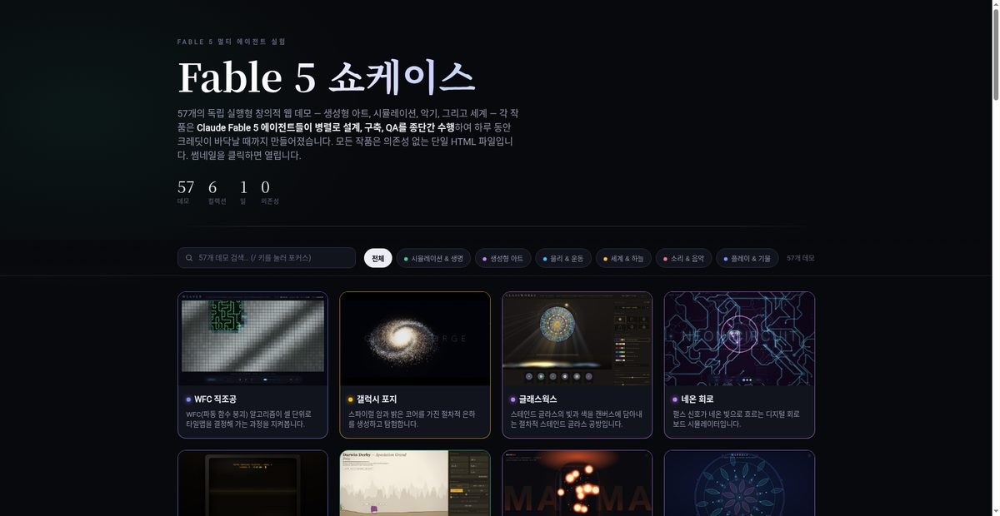

# The Fable 5 Showcase — 한국어판 (Fable 5 쇼케이스)

> **단일 프롬프트로 하루 동안 만들어진 57개의 독립 실행형 창의적 웹 데모 갤러리.**
> **Claude Fable 5 에이전트 군이 설계, 구축, 다듬기, QA를 종단간 수행했습니다.**

이 저장소는 간단한 질문에 대한 답입니다 — *"Fable에게 일주일치 Claude 사용 크레딧을 한 번에 소진하라고 시키면 어떻게 될까?"*

**57개의 독립 실행형(self-contained) 창의적 웹 데모** — 생성형 아트, 시뮬레이션, 악기, 절차적 세계 — 각 데모는 **Claude Fable 5** 에이전트 군이 병렬로, 단 하루 동안, 단일 프롬프트로부터 설계, 구축, 다듬기, QA 검증을 종단간 수행한 결과물입니다.

모든 데모는 **단일 `index.html` 파일 + 의존성 0** — 빌드 단계 없음, CDN 없음, 프레임워크 없음, 네트워크 요청 없음. 브라우저에서 아무 데모나 직접 열어 보세요.

## 📸 실제 실행 화면



## 컬렉션 (Collections)

| 컬렉션 | 예시 |
|---|---|
| **시뮬레이션 & 생명** | 보이드 무무레이션, 입자 생명(Primordia), 점균(Physarum) 슬라임, 산호초, 조수 웅덩이 생태계, L-system 정원 |
| **생성형 아트** | 프랙탈 보이저, 오라클(주역), 아르카나(타로), 글래스웍스 스테인드 글라스, 직기(Loom) 기하, 쇼도(書道) 캘리그래피, 만다라 |
| **물리 & 운동** | n-body 오비탈 샌드박스, 이벤트 호라이즌(블랙홀 렌즈), 클라드니(Chladni) 사이매틱, 클락워크 톱니바퀴, 웨이브랩 리플 탱크 |
| **세계 & 하늘** | 오로라, 끝없는 고딕 대성당, 핼시온(영화 같은 바다), 메트로폴리스, 테라 미니어(주머니 행성), 헥스크롤 맵 |
| **소리 & 음악** | 프리즘(빛 신스), 하모니아(플레이어블한 5도 원), 미드나잇 라디오, 스웜 심포니 |
| **플레이 & 기물** | 네뷸라 틸트 핀볼, 모래가 떨어지는 테라리움, 미로 천문대, 누아르 터미널, 크로노스(시계 동물원), 젠 라케(고요한 정원) |

## 어떻게 만들어졌나 (How it was made)

**단일 프롬프트 → ~275개의 Claude Fable 5 서브에이전트 실행** — 각 데모는 *설계 → 구축 → 강화 → QA* 파이프라인을 거쳐 백그라운드 다중 에이전트 워크플로로 처리되었습니다 — 일주일치 API 크레딧이 바닥날 때까지.

```
단일 프롬프트
   ↓
[Claude Code 멀티 에이전트 워크플로]
   ↓
57개 데모 (각자 독립 파이프라인)
   ├─ Design       (시각 컨셉 + 인터랙션 설계)
   ├─ Build        (단일 HTML에 캔버스 + JS 구현)
   ├─ Enhance      (폴리싱 + 이펙트 + 사운드)
   └─ QA           (브라우저 렌더 + 인터랙션 검증)
   ↓
썸네일 = 헤드리스 브라우저로 렌더 → 갤러리에 data URI로 임베드
```

> **흥미로운 점**: 썸네일 캡쳐도 헤드리스 브라우저로 각 데모를 직접 렌더링한 결과입니다. 그래서 갤러리는 완전히 self-contained — 외부 자산 호출이 0건입니다.

## 원본 프롬프트 (Prompt)

```
ok i have a challenge for you! i need to use up my anthropic api credits for the week
in one day, and ONLY on fable 5!! lets see if we can't build something that leverages
our claude code cli thats authed to build a bunch of epic demos for fable 5 of all
sorts of different complex cool creative projects! leverage fable 5's full creativity
and intelligence until our credits are gone!! tons of stuff in parallel!
```

> *번역: 한 주의 Anthropic API 크레딧을 하루 만에 다 쓰고 싶어, 그리고 오직 Fable 5만 사용해서! Claude Code CLI를 활용해 멋진 데모들을 만들어보자. Fable 5의 창의성과 지능을 총동원해서 크레딧이 바닥날 때까지! 병렬로 엄청나게 많이!*

## 구조 (Structure)

```
.
├── index.html              # 갤러리 (검색 가능, 카테고리 필터, 썸네일 인라인 임베드)
├── <demo-name>/index.html  # 각 개별 데모 (단일 파일)
└── thumbs/                 # 캡쳐된 미리보기 이미지 57장
```

**라이브 데모**: https://sigco3111.github.io/FABLE-SHOWCASE/

## 특징 (Features)

- ✅ **빌드 단계 0** — 정적 HTML, Vercel/Netlify/GitHub Pages 어디든 그대로 호스팅
- ✅ **네트워크 요청 0** — CDN, 외부 폰트, 외부 스크립트 일절 없음
- ✅ **의존성 0** — 모든 것이 단일 HTML 안에 캔버스 + 바닐라 JS
- ✅ **오프라인 동작** — 인터넷 끊어도 그대로 작동
- ✅ **모바일 친화** — 각 데모가 자체 반응형 레이아웃 포함

## 기술 스택 (Tech Stack)

- **HTML5 Canvas 2D** (대부분의 데모)
- **바닐라 JavaScript** (프레임워크 없음)
- **Web Audio API** (사운드 있는 데모: 아르카나, 프리즘, 하모니아 등)
- **SVG** (벡터 데모: 아르카나, 만다라, 글래스웍스 등)
- **CSS 애니메이션** + `requestAnimationFrame` 시뮬레이션 루프

## 컬렉션별 데모 목록 (Demos by Collection)

### 🎨 시뮬레이션 & 생명
| 데모 | 설명 |
|---|---|
| **보이드 무무레이션** | 황혼에 매를 피해 도는 보이드 떼 |
| **셀룰러 대성당** | Conway의 생명 게임과 이색 규칙 셀룰러 오토마톤 |
| **다윈 더비** | 험한 지형을 정복하는 유전 알고리즘 자동차 |
| **입자 생명** | 자가 조직화하는 입자 시뮬레이션 |
| **엘시스템 가든** | L-system 재귀 규칙의 절차적 식물원 |
| **잔불** | 한밤중의 아늑한 캠프파이어 + 반딧불이 |
| **산호초** | 형광빛 산호초 + 물고기 떼 생태계 |
| **슬라임 몰드** | Physarum 균사체의 경로 탐색 |
| **조수 웅덩이** | 파도와 해류가 만드는 미니 생태계 |

### 🎨 생성형 아트
| 데모 | 설명 |
|---|---|
| **아르카나** | 절차적 타로 3장 스프레드 |
| **크리스탈라이즈** | DLA 확산 한정 집합 결정 성장 |
| **잉크 플로우** | 일본 서예 추상화 |
| **만다라** | 대칭 반복 힌두/불교 만다라 |
| **글래스웍스** | 절차적 스테인드 글라스 |
| **오라클** | 동양 역경(易經) 점술 64괘 |
| **쇼도** | 일본 서예 절차적 캘리그래피 |
| **워드스미스** | 절차적 시 atelier — 매번 새로운 시 인쇄 |

### 🧲 물리 & 운동
| 데모 | 설명 |
|---|---|
| **클라드니** | 사이매틱 정상파 + 입자 마디선 |
| **클락워크** | 진짜 기어비 톱니바퀴 작업대 |
| **이벤트 호라이즌** | 블랙홀 주변 빛의 중력 렌즈 |
| **진자 카오스** | 다중 진자 카오스 패턴 |
| **반응-확산** | Gray-Scott 반응-확산 시뮬레이션 |
| **웨이브랩** | 파동의 간섭과 회절 리플 탱크 |

### 🌌 세계 & 하늘
| 데모 | 설명 |
|---|---|
| **오로라** | 북극의 빛이 별하늘을 가로질러 흘러내림 |
| **셀룰러 대성당** | Conway의 생명 게임으로 자라는 신전 (시뮬 교집합) |
| **인피니트 대성당** | 끝없이 이어지는 고딕 양식 신전 |
| **메트로폴리스** | 절차적 도시 — 차량, 불빛, 리듬 |
| **테라 미니어** | 바이옴 + 구름 + 야경의 작은 행성 |
| **헥스크롤** | 절차적 헥사곤 보드게임 맵 |
| **웨더베인** | 해/안개/폭풍/눈 변화 디오라마 |
| **테라포밍** | 고도/온도/습도별 생태계 변화 |

### 🎵 소리 & 음악
| 데모 | 설명 |
|---|---|
| **프리즘 신스** | 빛으로 연주하는 신시사이저 |
| **하모니아** | 5도 원 플레이어블 멜로디 즉흥 |
| **미드나잇 라디오** | AM 라디오 + 정체불명 신호 청취 |
| **스웜 심포니** | 군집 알고리즘이 들려주는 살아있는 오케스트라 |

### 🎲 플레이 & 기물
| 데모 | 설명 |
|---|---|
| **네뷸라 틸트** | 절차적 핀볼 테이블 |
| **샌드폴** | 떨어지는 모래를 칠해서 변화 |
| **미로** | 절차적 미로 생성 + 알고리즘 시각화 |
| **누아르 터미널** | 1940년대 누아르 미스터리 텍스트 어드벤처 |
| **크로노스** | 같은 시각을 알리는 서로 다른 시계 동물원 |
| **키네틱 타입** | 살아 움직이는 활자체 |
| **포스터 스튜디오** | 베르사유풍 포스터 디자이너 |
| **별점 맵(Constellation)** | 살아있는 별자리 컨셉 맵 |
| **복셀 아틀리에** | 복셀 단위로 3D 조각 |
| **WFC 직조공** | 파동 함수 붕괴 타일맵 생성 |
| **젠 라케** | 카레산스이 정원의 모래 괘 |

## 기여 & 라이선스

이 저장소는 **elder-plinius/FABLE-SHOWCASE**의 한글화 포크입니다.

- **원작자**: [elder-plinius](https://github.com/elder-plinius) (Pliny the Liberator)
- **원본 저장소**: https://github.com/elder-plinius/FABLE-SHOWCASE
- **한국어판**: https://github.com/sigco3111/FABLE-SHOWCASE
- **라이선스**: 원본과 동일 (저장소 라이선스 참조)

---

**Built with [Claude Code](https://claude.com/claude-code) · 한글로 다시 만나보세요 ✨**
